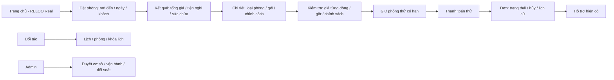
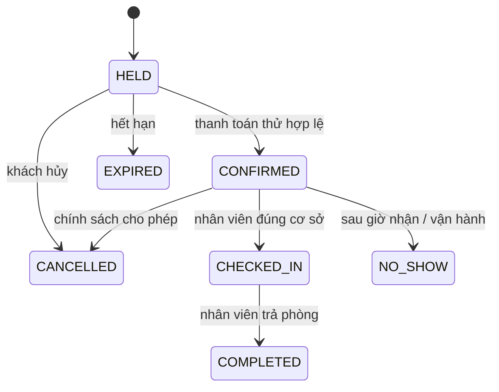

# RELOO Real · Đặt phòng — đặc tả trước triển khai

Ngày 22/10/2026, Asia/Ho_Chi_Minh. Trạng thái: D — đề xuất RELOO; bản demo local, chưa mở bán, chưa triển khai production. Không có hợp đồng/API nguồn phòng được cung cấp. Chọn mô hình đối tác đăng và RELOO duyệt; adapter tích hợp chính thức để sau. Không nhập phòng, giá, ảnh hay tồn của Dayladau.

## Điều hướng và màn hình chính

Danh sách dùng thẻ trắng, token xanh `--reloo-primary`, nền `--reloo-canvas`, typography sẵn có, Lucide. Không dùng ảnh thương mại tham chiếu: minh họa phòng bằng CSS, nhãn demo luôn hiện. Form tìm kiếm 4 trường; chi tiết và kiểm tra là hai bước rõ, CTA dưới nội dung. Mobile một cột, desktop thẻ 3 cột, nút >=44px, safe area, không animation bắt buộc. Dùng LocaleProvider vi-VN/en-US, Intl VND và giờ Việt Nam. Back đi đúng màn hình và giữ bộ tìm kiếm; thay ngày làm mất báo giá cũ; lỗi API không giả thành công. Chỉ hỏi vị trí khi người dùng chọn gần đây, không tracking nền; bản đầu không bật vị trí khi chưa có adapter phù hợp.

## Nghiệp vụ đề xuất và ranh giới

Demo hỗ trợ **theo ngày**: 14:00 nhận, 11:00 trả giờ Việt Nam, 60 phút vệ sinh; đây là cấu hình thử, không phải chính sách thương mại được duyệt. Giờ/qua đêm chờ xác nhận nghiệp vụ nên không hiển thị khả dụng. Tồn bán là các unit cụ thể thuộc room type; giao nhau tính nửa mở `[checkin, checkout + buffer)`. Server khóa room type trong transaction trước chọn unit, chặn oversell cả giữ phòng và khóa lịch. Hold demo 10 phút. Expire lười trước mỗi lệnh; production cần worker định kỳ. Báo giá có version, TTL 5 phút, snapshot từng dòng và policy; server tính số tiền. Không nhận giá client. Demo không phụ thu/thuế/khuyến mại chưa được duyệt; breakdown ghi rõ phí thử bằng 0, không tuyên bố giá production.

Order, payment (`UNPAID/PAID/FAILED`), refund (`NONE/REVIEW_REQUIRED/REFUNDED`) độc lập. Callback idempotent theo event id; callback thành công muộn ghi nhận tiền nhưng không phục hồi tồn, tạo REVIEW_REQUIRED để đối soát. Hoàn tiền demo trước nhận phòng là 100% **chỉ fixture thử**; production chưa có policy được duyệt nên khóa. Mọi chuyển trạng thái có actor/reason/time, role kiểm tra server. Khách chỉ thấy đơn của mình; nhân viên membership theo property; admin dùng CRM quyền được cấp, không tin actor/role từ payload. Không có nền tảng fee/payout thật khi chưa phê duyệt.

## Schema và API contract

Migration `supabase/migrations/20261022120000_room_booking.sql`: properties → room_types → units; membership/property scope; orders snapshot; payment_events idempotent; audit append-only; blocks; outbox dedupe. RPC backend-only. PostgreSQL transaction + khóa row room type, không dựa vào state client hay mutex một process. Mọi bảng RLS và revoke PUBLIC/anon/authenticated; service_role backend gọi RPC với actor đã xác minh. Mọi thay đổi giá/khóa lịch dùng cùng khóa type để không race checkout.

`GET /api/stays`: catalog demo và enabled/testMode; không chứa dữ liệu khách. `POST /api/stays`: origin/rate/body limit; op quote, hold, pay-test, mine, order, cancel-preview, cancel. Quote input roomTypeId, checkIn/checkOut ISO date, guests; hold thêm quote/version và Idempotency-Key. Trả JSON `{ok,data}` hoặc `{ok:false,code,error}` với no-store. 400 invalid, 401 auth, 403 scope, 409 sold out/price changed/state/expired, 503 unavailable. Production mutations bị khóa cho đến khi adapter/payment/policy được phê duyệt. Demo local dùng actor cố định dữ liệu tổng hợp, không mượn tài khoản thật; không nhận header actor tùy ý.

Adapter phòng tách catalog/quote/hold; thanh toán tách simulator chỉ local, production phải dùng hạ tầng RELOO với verified webhook, idempotency và reconciliation, không suy đoán giao thức nhà cung cấp. Outbox có id duy nhất theo order/event; worker production phải nối thông báo hợp nhất, deep link kiểm tra quyền; chưa gửi email/push thật. Map chỉ tọa độ demo, không tải nhà cung cấp tự động. Vouchers trả unavailable cho tới khi có policy và adapter. Đổi lịch phải re-quote + atomic swap tồn, không sửa đơn đã trả tiền tại client.

## Quản lý và rollout

Đối tác: draft → pending → approved/suspended; staff membership chỉ property được cấp; calendar/unit blocks; room type ≠ unit count; giá có version; lifecycle audit; refund review/support. Admin duyệt nội dung và policy trước publish; không cho partner tự approve. Đối soát/payout chưa áp dụng cho demo. Những màn hình chưa triển khai cần được ghi rõ trong kết quả, không gọi spec là chức năng đã chạy.

Đọc README có các mô tả demo cũ; mã thực tế dùng HttpOnly auth qua requireAccount, Supabase service client backend, origin/rate và CRM permissions. Web Next16 App Router/React19; mobile Capacitor tải https://reloo.vn, không có backend booking riêng. Tận dụng MarketplaceShell, IntentLink, LocaleProvider. Không thay auth/thuê đồ/nội khu. Không sửa runtime production hay native config để chạy local.

Trước rollout: duyệt mô hình/giá/hủy, adapter nguồn có quyền, thanh toán thật và webhook, worker expiry/outbox/reconciliation, privacy/retention, QA Samsung/iPhone/Android và regression. Apply migration rồi `deploy/vietnam/security-lockdown.sql`, security test, verify cùng build backend/web renderers và runtime/catalog mọi client. Local demo không đồng nghĩa app đang cài đã nhận module.
