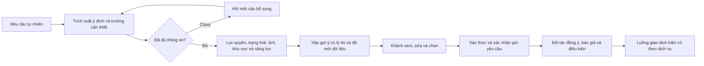

# Khảo sát Donee và cơ hội cho RELOO — 24/10/2026

## Phạm vi và cách đọc kết luận

Yêu cầu: khảo sát mô hình app Donee đã cài, tra cứu nguồn chính thức và đề xuất cách áp dụng vào RELOO. Lượt này là nghiên cứu, không mở dịch vụ Job, mua Premium, đăng hồ sơ hay thay chính sách. Đọc REA_WORKFLOW, checklist và registry Guardian trước khi ghi tài liệu. Rule liên quan: 005–010, 012–013, 019–020; RELOO-JOBS, TRUST, PAYMENTS. Không thêm trường dữ liệu, tài sản sản phẩm, SDK hoặc nhà cung cấp.

- **A — quan sát trực tiếp:** màn hình trên Samsung và metadata package; chứng minh UI tại thời điểm khảo sát, không chứng minh backend.
- **B — nguồn chính thức:** website/Play Store/chính sách do Donee công bố; là tuyên bố của họ, không phải kiểm toán độc lập hay kết luận pháp lý.
- **C — suy luận:** giả thuyết sản phẩm/kỹ thuật cần xác minh.
- **D — đề xuất RELOO:** thiết kế độc lập, chưa phải tính năng đã triển khai hoặc chính sách được duyệt.

Thiết bị thực tế: Samsung **SM-N950N**, ADB37.0.1, trạng thái `device`. App **global.donee.app**, version **1.0.7 / code91**, installer `com.android.vending`. REA package Evidence `ev_d54066e834264d135ffb8570fce99371306de374bc501fe70e902eb4089086ad`. Không kiểm chứng chữ ký, không pull APK, không truy cập token/private storage, không MITM/decompile. App có phiên đăng nhập sẵn, hồ sơ hiển thị0%; không đăng xuất hoặc thay thông tin thật. Fine/coarse location đã được cấp sẵn theo dumpsys; không thay quyền và không suy ra app đang theo dõi nền. Không tái hiện onboarding/đăng nhập.

REA MCP thiếu đường dẫn adb trong môi trường server. Dùng **CLI6.5.0 đã pin** với `REA_ADB_PATH` trỏ adb đã có, chỉ trong tiến trình khảo sát; không sửa cấu hình MCP, cài engine hay nâng toolchain. Search connector lỗi HTTP500; tiếp tục đọc trực tiếp website và Google Play chính thức. Ngày kiểm tra24/10/2026 theo Asia/Saigon; giờ trên status bar Samsung không dùng làm timestamp chuẩn. File evidence giữ timestamp filesystem và hash. Tài liệu nghiên cứu làm thay đổi source identity tài liệu; không gán bằng chứng release cũ cho source mới.

## Mô hình xác định được

**B:** [Google Play](https://play.google.com/store/apps/details?id=global.donee.app&hl=vi) và [website](https://donee.global/) mô tả nền tảng kết nối dịch vụ bằng hội thoại: người cần mô tả nhu cầu, AI hỏi thêm và gợi ý người cung cấp, hai bên trao đổi trực tiếp. Một tài khoản dùng được cả hai vai trò theo tình huống. Các nhóm công khai gồm việc nhà, sửa chữa, tài xế, trợ lý, đồng hành trải nghiệm, làm đẹp và sức khỏe tại nhà. Đây là mô hình kết nối cung–cầu dịch vụ, không chỉ là bảng tuyển dụng truyền thống.

**B:** [Điều khoản](https://donee.global/terms/vi), phiên bản20260811.1, mục2/4–6: Donee tự mô tả vai trò hạ tầng kết nối; thỏa thuận, thanh toán và thực hiện dịch vụ giữa hai bên nằm ngoài nền tảng. Premium là đăng ký qua cửa hàng ứng dụng, tự gia hạn; hủy/hoàn theo cửa hàng. Không xác minh việc thực thi trách nhiệm, trạng thái IAP hay toàn bộ mô hình doanh thu từ UI.

**A:** FAQ phí nói hiện chưa thu phí tạo hồ sơ/gợi ý/kết nối, có thể áp dụng sau; màn Premium hiển thị gói trả phí. Hai thông tin có thể nói về phí cơ bản và gói nâng cao khác nhau; không kết luận lỗi pháp lý hoặc mọi tính năng miễn phí.

**A:** tài khoản khảo sát hiển thị10/10 lượt kết nối còn lại hôm nay, làm mới hằng ngày. Paywall hiện: 1tháng499.000đ; 6tháng2.599.000đ, tương đương433.167đ/tháng; 12tháng3.999.000đ, tương đương333.250đ/tháng. Đây là giá hiển thị trên thiết bị/phiên khảo sát, không phải giá cố định mọi thị trường hay giá RELOO. Không bấm đăng ký hoặc mở xác nhận mua.

**A:** đặc quyền Premium được UI mô tả gồm lọc tin nhắn từ hội viên, tích xanh, dịch tin nhắn, ưu tiên đề xuất, tiếp cận người chỉ nhận Premium và gấp đôi lượt kết nối/ngày. Chưa chứng minh xếp hạng thật, khả năng dịch hay quy trình xác thực. Tích xanh trả phí không nên được RELOO diễn giải thành xác minh danh tính hoặc bảo đảm an toàn.

## Danh mục hành trình và bằng chứng

Đã xác định nhóm cần khảo sát: nhận diện/phiên đăng nhập; khám phá; nhập nhu cầu/AI; kết nối/chat; hồ sơ nhà cung cấp; hạn mức/Premium; trợ giúp; quyền riêng tư/xóa; trạng thái lỗi/rỗng. Thao tác chỉ điều hướng và xem trước; dừng trước gửi nhu cầu, liên hệ người thật, lưu hồ sơ, mua hay xóa.

Ảnh/XML và REA evidence nằm trong ignored `output/rea/donee/`. Mỗi thư mục ảnh có `screen.png`; file `*-evidence.json` chứa ID và SHA256 frame. [Thư viện có chú thích](../output/rea/donee/index.html).

| Màn/luồng | Thao tác vào | Quan sát A | Bằng chứng / giới hạn |
|---|---|---|---|
| Cá nhân, phần dưới | REA mở launcher, khôi phục vị trí phiên cũ | Dịch vụ, chỉnh sửa hồ sơ, ngôn ngữ, Premium, quyền nhận tin, trợ giúp, pháp lý, tài khoản | `01-launch`; không đổi cài đặt |
| Nhắc hoàn thiện hồ sơ | Bấm tab Khám phá | Modal có CTA hoàn thiện và “Để sau”; nội dung tự tuyên bố hồ sơ đầy đủ được AI ưu tiên | `02-discover`; chọn Để sau, không xác nhận tuyên bố thuật toán |
| Trang khám phá | Đóng nhắc hồ sơ | Lời chào chung, chip ngành nghề, lịch sử trò chuyện, ô nhập nhu cầu và3tab | `03-home`; không bấm chip/gửi vì có thể tạo yêu cầu |
| Danh sách FAQ | Bấm dấu hỏi trên Khám phá | Phân nhóm phí, tìm người, hồ sơ và nhận khách | `04-help` |
| FAQ phí | Mở accordion phí | Phí cơ bản hiện chưa thu, khả năng thu sau | `05-help-fees` |
| FAQ tìm người | Đóng phí, mở tìm người | Hướng dẫn dùng ngôn ngữ tự nhiên, AI hỏi thêm rồi gợi ý | `06-help-matching`; chỉ đọc hướng dẫn, chưa chạy match |
| Cá nhân, phần trên | Quay lại, chọn Cá nhân, cuộn lên | Hồ sơ0%, hạn mức10/10, khu vực cấp thành phố, thêm dịch vụ | `07-profile-top`; không thu vị trí chi tiết |
| Premium, giá | Bấm Nâng cấp | 3chu kỳ, giá quy đổi và tổng trả, CTA đăng ký | `08-premium`; không bấm CTA |
| Premium, đặc quyền | Cuộn paywall | Các quyền nâng cao, tự gia hạn/hủy | `09-premium-benefits`; không thực thi các quyền |
| Form nhà cung cấp | Quay lại, bấm Thêm dịch vụ | Đi vào form hồ sơ; tên, ngày sinh, giới tính, quốc tịch, giới thiệu và dịch vụ đánh dấu bắt buộc; giới thiệu tối đa2000ký tự | `10-provider-form`; không nhập dữ liệu/submit validation |
| Form dịch vụ con | Bấm Thêm dịch vụ trong form | Thêm một khối local trống: tên, giá, tiền tệ mặc địnhVND, đơn vịgiờ và mô tả; Lưu bị vô hiệu khi chưa đủ thông tin | `11-service-picker` là tên artifact lịch sử, thực tế **không phải picker danh mục**; không chọn giá/tiền tệ, không lưu |
| Trở lại hồ sơ | Android Back | Hồ sơ vẫn0%, chưa có dịch vụ | `12-return-profile`; UI xác nhận chưa có tin đã lưu, không khẳng định trạng thái backend ngoài quan sát |

Chưa kiểm thử: AI trả lời thực tế, broadcast/phân bổ, hồ sơ gợi ý, contact/chat với người thật, lịch sử riêng tư, thực hiện dịch vụ, hủy/hoàn, receipt/subscription webhook, offline/timeout, chống gian lận, tài khoản khác và flow mới cài. Không gửi một tin “thử” vì có thể tạo lead hoặc liên hệ người thật. Không phát hiện đầy đủ thuật toán hay hệ thống vận hành nội bộ từ các màn này.

## Quyền riêng tư: chỉ ghi nhận, không áp dụng nguyên mẫu

**B:** [Chính sách](https://donee.global/privacy/vi), phiên bản20260811.1, mục3/4/6/9/10 nêu dùng vị trí cho matching, chỉ hiển thị khu vực/khoảng cách tương đối; dùng trao đổi/hành vi để cải thiện AI; công khai một số chỉ số hoạt động; dùng AWS có thể ngoài Việt Nam. Chính sách mô tả vài mục đích không có lựa chọn từ chối khi tiếp tục dùng. Đây không phải bằng chứng lưu trữ thực tế hoặc căn cứ để RELOO gộp consent/huấn luyện chat.

**B:** [Hướng dẫn xóa](https://donee.global/delete-account/vi) nêu khóa hoạt động khi yêu cầu, chờ30ngày, đăng nhập lại có thể kích hoạt, sau đó xóa/khử nhận dạng với ngoại lệ lưu giữ. Xóa tài khoản không tự hủy đăng ký cửa hàng. Chưa thực hiện thao tác xóa. Đánh giá tính phù hợp pháp luật hiện hành của các điều khoản này nằm ngoài khảo sát, **NEEDS_LEGAL_REVIEW**, không tự kết luận hợp pháp/vi phạm.

## Quan sát → bài học → áp dụng vào RELOO

| Nguồn/bài học | D — áp dụng phù hợp | Phần RELOO hiện có / khoảng trống |
|---|---|---|
| A/B: nhập nhu cầu qua hội thoại | Một ô “Bạn cần gì?” nhận câu tự nhiên, kèm vài chip ví dụ; vẫn cho xem/tìm/lọc thủ công | `components/support/SupportChat.jsx`, `lib/support/advisor.js` có chat ngữ cảnh; chưa có job dispatch |
| A/B: hỏi thêm trước kết nối | Hỏi tối đa một thông tin quyết định mỗi lượt: loại việc/đồ, khu vực, lịch, ngân sách; tóm tắt sửa được trước gửi | API báo giá và lựa chọn thuê có cấu trúc; chưa có schema yêu cầu dịch vụ |
| A: provider nhiều dịch vụ | Một tài khoản, hồ sơ chuyên môn riêng theo lĩnh vực, nhiều gói có đơn vị giá rõ | Tài khoản/đăng tin có sẵn; không đồng nhất CV, hồ sơ nghề, chủ nhà và quyền admin |
| A: hoàn thiện hồ sơ có lợi ích rõ | Chỉ nhắc các mục thực sự thiếu cho loại dịch vụ, có để sau khi chưa giao dịch | Không yêu cầu quốc tịch/giới tính mặc định cho thuê đồ; mục đích/phạm vi từng trường phải được duyệt |
| A: hạn mức + Premium | Có thể nghiên cứu thuê bao công cụ cho người cung cấp: lịch, CRM, dịch, báo cáo; hạn mức minh bạch | Chưa triển khai bán gói hoặc thay phí; không mua thứ hạng như tín hiệu an toàn |
| A/B: direct chat | Kết nối có xác nhận, che liên hệ/địa chỉ đến đúng giai đoạn, report/block | RELOO có peer messaging và xác thực; cần quyền hội thoại theo request + chống spam khi mở Job |
| B: off-platform services | RELOO cần quyết định rõ vai trò từng loại giao dịch, lưu điều kiện và bằng chứng thực hiện | Luồng thuê/cọc/báo giá đang có không chuyển sang off-platform chỉ vì tham khảo Donee |
| B: vị trí tương đối | Lọc theo khu vực tự chọn trước; xin GPS đúng lúc, không theo dõi nền để tìm việc | `lib/catalog/public-listing.js` đã có coarse projection; agent API không xuất PII |

## Thiết kế thuật toán RELOO đề xuất — không phải thuật toán Donee

**D — nguyên tắc:** mô hình chỉ trích xuất schema/đề xuất, không quyết định tiền hoặc cấp quyền. Lọc cứng trước xếp hạng: hồ sơ được duyệt, còn hoạt động, đúng nhóm nghề/khu vực, khả năng nhận lịch và không bị block; không có dữ liệu xác thực thì báo chưa xác minh. Ranking có thể dựa độ khớp chuyên môn, thời gian, khoảng cách cấp khu vực, chất lượng giao dịch đủ mẫu và phân phối cơ hội; trọng số phải thử nghiệm trên fixture, chưa tự đặt thành chính sách kinh doanh. Tách tài trợ khỏi lý do phù hợp, không dùng giới tính/quốc tịch hoặc nội dung chat riêng để suy diễn khả năng trả tiền.

**D — phân bổ:** khách chọn người hoặc chủ động xác nhận gửi tới nhóm giới hạn; không tự spam mọi provider. Provider chủ động nhận/từ chối, có TTL, giới hạn tần suất và idempotency. Race hai người nhận phải được giải quyết server-side; không biến “đã gửi” thành “đã có người nhận”. Chat có phân quyền, chặn/báo cáo, không cho model tiết lộ số điện thoại/tọa độ. Log audit theo ID/sự kiện, không ghi prompt chứa PII không cần thiết. Học từ phản hồi chỉ theo mục đích/consent đã duyệt, có reset/withdrawal, không mặc định dùng nội dung chat huấn luyện.

## Ưu tiên triển khai khả thi

1. **Gần nhất:** nâng chat RELOO thành trợ lý làm rõ nhu cầu và hiển thị bản tóm tắt sửa được; thuê đồ/đồ cũ tra danh mục công khai hiện có; báo rõ đặt phòngdemo và Job chưa mở. Không cần thêm provider AI hoặc một hệ thống tài khoản mới. Đo số lượt hỏi đến kết quả hữu ích, tỷ lệ phải sửa tóm tắt và số báo giá/đề xuất không đúng, không chỉ lượng tin nhắn.
2. **MVP dịch vụ nội khu có kiểm soát:** trước tiên chọn vài nhóm ít phụ thuộc chuyên môn đặc thù (vận chuyển đồ nội khu, lắp ráp đồ thông thường, chụp ảnh); vẫn cần review phạm vi, an toàn, trách nhiệm và điều kiện nhận việc. Có provider thật được duyệt, service offer, yêu cầu, acceptance, quote snapshot và lịch sử. Không phát hành giả nếu chưa có nguồn cung.
3. **Công cụ người cung cấp:** lịch nhận việc, thời gian trống, gói giá/đơn vị, thông báo đúng sự kiện, phản hồi có giới hạn. Chỉ đánh giá thuê bao sau khi chứng minh chất lượng lead; chưa sao chép giá Donee hoặc auto gia hạn.
4. **Mở rộng sau review chuyên ngành:** chăm sóc trẻ/người già, điều dưỡng, sức khỏe, vận tải và dịch vụ có yêu cầu chuyên môn cần xét riêng. Không coi danh mục của đối thủ là giấy phép cho RELOO mở mọi ngành. Vai trò sàn dịch vụ khác tuyển dụng/quan hệ lao động cần được pháp lý phân loại theo hoạt động thực tế.

Chưa cần thay UI mini app thành màn chat duy nhất: có khách muốn hội thoại, có khách cần so sánh có cấu trúc. Điểm mạnh RELOO có thể là kết hợp **hỏi AI → so sánh rõ → kiểm tra tổng tiền/điều kiện → xác nhận**, tận dụng danh mục machine-readable đã có.

## Hồ sơ kỹ thuật cần trước khi mở MVP

Đề xuất schema tối thiểu (chưa migration): `service_offers`, `service_requests`, `service_matches`, `service_quotes` và sự kiện audit; reuse profile/conversation/notification hiện có. Tách `DRAFT → READY → SENT → ACCEPTED → QUOTED → CONFIRMED → IN_PROGRESS → COMPLETED`, nhánh EXPIRED/CANCELLED/DISPUTED; payment/refund có state riêng khi áp dụng. Chỉ server chuyển trạng thái theo vai trò. Mọi endpoint mutation cần auth, origin check, idempotency và quyền request/offer; actor không được sửa chủ thể hoặc nhận việc hộ người khác.

Điều kiện mở: có nguồn cung có quyền, danh mục được phép, mục đích/retention từng trường, thông báo/chia sẻ rõ ràng, quy trình xử lý sự cố và tranh chấp, test đồng thời/timeout/đổi lịch/hủy, vi/en và a11y/runtime evidence. Định nghĩa “lead đủ điều kiện”, phí/hoàn/thuê bao và ngân sách chưa được tự quyết ở lượt khảo sát này. Không chỉnh policy ràng buộc, không thêm tracking hoặc triển khai tính năng Job thật trong báo cáo nghiên cứu.

## Kết quả và giới hạn

12frame thiết bị, metadata package và5trang nguồn chính thức đã được lưu. Có bằng chứng UI cho khám phá, trợ giúp, hồ sơ, form dịch vụ và Premium; không tuyên bố khảo sát hết mọi màn, doanh thu thực tế hay thuật toán nội bộ. Màn native này có vùng status bar chồng nội dung ở một số vị trí trên Samsung; đây là quan sát giới hạn thiết bị/phiên, không đánh giá mọi máy. RELOO nên tiếp tục xử lý safe area theo thiết bị của mình.

Không gửi nhu cầu hoặc tin nhắn, không lưu nhà cung cấp, mua Premium, thay quyền/cài đặt hay yêu cầu xóa. Một khối form dịch vụ local trống đã được mở rồi Back; trang trở lại vẫn0% và chưa có dịch vụ. Đã xóa XML tạm tự tạo trên thiết bị sau khảo sát. Ảnh tham khảo chỉ là bằng chứng nội bộ, không được đưa vào tài sản thương mại RELOO. Chưa triển khai hoặc deploy tính năng mới trong lượt nghiên cứu này.
