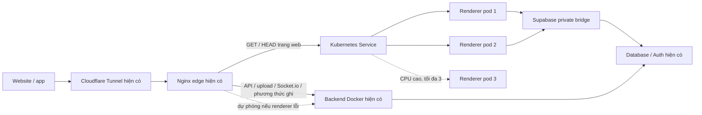

# RELOO Kubernetes — triển khai giai đoạn 1, 17/10/2026

## Đã cài và ranh giới

K3s `v1.37.1+k3s1`, phiên bản và SHA-256 trong `tools/kubernetes-toolchain.json`, được cài trên Ubuntu/WSL hiện có tại Việt Nam. Runtime cuối là **containerd riêng** (`containerd://2.3.4-k3s1`); image ứng dụng được nhập từ image Docker đã kiểm tra, không build một ứng dụng khác. Không đổi tài khoản Cloudflare, không mua máy/dịch vụ, không chuyển database hoặc dữ liệu khách sang nhà cung cấp khác.

**Hiện chỉ có một máy vật lý.** Hai pod không phải hai máy dự phòng. Kubernetes khôi phục pod/tiến trình, không giữ website hoạt động nếu Windows/WSL, nguồn điện, ổ C hoặc Internet của máy đó ngừng hoạt động. Chưa có multi-node, HA control plane, database failover hay Cluster Autoscaler cấp máy mới.



Đây là cân bằng tải **dựng trang**, không phải tự động nhân bản tất cả backend. API ghi, upload, thanh toán, worker AI và Socket.io giữ một backend có thẩm quyền vì hiện dùng rate limit/room trong tiến trình, file cục bộ và các ràng buộc nghiệp vụ. Không âm thầm chia room chat, nới hạn mức hoặc chạy nhiều worker gây gọi API/đăng bài lặp. Provider 429 và giới hạn database không được loại bỏ bởi Kubernetes.

## Cấu hình hoạt động

| Hạng mục | Cấu hình |
|---|---|
| Web renderer | Deployment, 2 replica, tối đa 3 qua HPA CPU 70% của request |
| Tài nguyên mỗi pod | Request 250m CPU / 384 MiB RAM; limit 1 CPU / 1 GiB RAM |
| Rolling update | maxUnavailable 0, maxSurge 1; giữ 3 revision |
| Health | startup, readiness, liveness; ứng dụng tự xử lý SIGTERM; preStop 8 giây |
| Gián đoạn chủ động | PDB minAvailable 1; không bảo vệ khỏi máy chủ chết |
| Dữ liệu | Renderer không mount media, giấy tờ hoặc Docker socket; chỉ tmp/cache giới hạn trên RAM |
| Bảo mật pod | UID/GID 1000, read-only root, drop ALL capabilities, seccomp RuntimeDefault, không mount service-account token |
| Mạng | NetworkPolicy; quản trị K3s/kubelet trên Tailscale; NodePort chỉ địa chỉ Tailscale, không mở cổng public |
| Secrets | Lấy từ backend khỏe trên server, chỉ đưa vào Kubernetes Secret; mã hóa at rest; không xuất kubeconfig/token ra laptop/Git |
| Routing | Nginx giữ các hạn mức cũ, cổng API và origin Socket.io; GET/HEAD có backend Docker dự phòng, không tự retry giao dịch ghi |
| Image | Tag bất biến từ image ID backend khỏe; imagePullPolicy Never, không dùng latest cho pod |
| JS/CSS qua nhiều release | Archive immutable dùng chung trong `/srv/reloo/data/web-static`; Nginx nội bộ read-only phục vụ cả bản cũ/mới, có fallback về app; không mount hostPath vào renderer |
| Đồng bộ release | Timer 60 giây: nhập image mới vào containerd và đồng bộ env khi backend mới healthy, cập nhật private gateway EndpointSlice, không reset replica HPA mỗi lần |
| Sao lưu | SQLite online snapshot + token + khóa mã hóa + config, tar/GPG AES-256, timer 6 giờ; passphrase root-only hiện có |
| Dung lượng Windows | Preflight tối thiểu 20 GiB trống, tối thiểu 4 GiB RAM khả dụng; dưới 15 GiB dừng đồng bộ/import image mới; dưới 10 GiB thêm taint NoSchedule và ghi snapshot, không giả định dung lượng Linux là ổ C thật |

Giới hạn replica là cấu hình theo máy 4 CPU / khoảng 12 GB RAM hiện tại, không cam kết số khách đồng thời. Docker AI/database vẫn ở ngoài scheduler; phải theo dõi tổng RAM/CPU khi chạy các model AI lớn. Không bật thêm dashboard công khai, ingress chiếm cổng 80/443, service load balancer trả phí hay các add-on không cần thiết.

## Source và vận hành

- `deploy/kubernetes/resources.mjs`: manifest factory và chuyển đổi edge có kiểm tra cấu hình trước khi ghi.
- `preflight.sh`, `install.sh`: kiểm tra máy, kiểm SHA, cài bản cố định; timer rollback mạng khi lần cài đầu chưa được xác nhận.
- `reconcile.py`: init/canary/sync/status/edge-enable/edge-disable, không in secrets; giữ nguyên số replica khi HPA đang điều khiển.
- `firewall.sh` và unit: chỉ sửa chain riêng RELOO-K3S-IN, giữ nguyên Docker/Tailscale; chặn cổng quản trị/overlay ngoài giao diện riêng.
- `backup.py`, các service/timer: bản sao lưu mã hóa và đồng bộ release.
- `verify-runtime.py`, `verify-autoscaling.py`: kiểm thử có giới hạn, test namespace riêng, không tiền/giao dịch/tin nhắn thật.
- `scripts/collect-operations.py`, `lib/operations/infrastructure*.js`, `ControlInfrastructure.jsx`: đưa số tổng hợp Kubernetes và ổ C vào CRM, tách snapshot cũ với số hiện tại; không lộ pod identity, node IP, env hoặc kubeconfig.

Các script runtime ở `/srv/reloo/kubernetes`, trạng thái root-only `/var/lib/reloo-k3s/status.json`. Không gọi `init` lặp trong lịch tự động: init tạo cấu hình ban đầu, `sync` mới là thao tác theo lịch.

Chuẩn bị gói có thể review từ repo (không tự kết nối/deploy): `node deploy/kubernetes/prepare.mjs --node 100.107.146.119 --output output/kubernetes/ready --download`. Flag download chỉ lấy đúng artifact trong lock và kiểm hash. `resources-base.json` là template có endpoint/image placeholder; **không apply trực tiếp**. Trên server, `reconcile.py init` mới lấy image khỏe, env server và endpoint Docker thật trước server-side dry run/apply. Không đưa gói có Secret đã resolve vào Git hoặc trang preview công khai.

Qua SSH Tailscale, chạy trên server (không đưa mật khẩu vào command/chat):

```sh
k3s kubectl --server=https://100.107.146.119:6443 get nodes
k3s kubectl --server=https://100.107.146.119:6443 get pods,hpa,pdb -n reloo
python3 /srv/reloo/kubernetes/reconcile.py status
systemctl status reloo-kubernetes-sync.timer reloo-kubernetes-backup.timer
journalctl -u reloo-kubernetes-sync.service --since '-15 minutes'
```

Không xuất `kubectl get secret -o yaml`, nội dung kubeconfig, Docker env hay khóa giải mã vào log. Khi sync lỗi: kiểm tra backend Docker healthy, gateway riêng và các EndpointSlice trước; không đổi image sang bản chưa xác minh hoặc bỏ NetworkPolicy để chữa tạm.

## Rollback và phục hồi

```sh
# Trả tất cả routing về Docker, không xóa database, media hay đơn khách.
python3 /srv/reloo/kubernetes/reconcile.py edge-disable
systemctl stop reloo-kubernetes-sync.timer
```

Sau khi xác nhận website/API vẫn khỏe có thể giảm renderer. Không chạy uninstall/killall hoặc flush iptables để thử trên production. Khôi phục cluster từ backup cần dừng K3s, kiểm bản sao SQLite/token/encryption config khớp nhau trong môi trường phục hồi trước; **không restore database giao dịch** từ snapshot cũ để rollback giao diện.

Backup được thử giải mã và PRAGMA integrity_check trên bản SQLite tạm, không thay thế cluster production. Quy trình DR trên máy thay thế/mất máy vật lý chưa được diễn tập; lịch backup không đồng nghĩa đã có HA/offsite độc lập.

## Bằng chứng kiểm thử thật

- Node Ready; CoreDNS và Metrics Server Running, HPA đọc CPU thật, hai renderer Ready.
- Xóa một pod: pod mới được tạo, 6 probe canary đều 200.
- 12 yêu cầu đọc riêng: cả hai endpoint có bộ đếm NAT tăng, chứng minh phân phối kết nối.
- Proxy canary riêng trên loopback, tắt renderer: ba lần fallback đều 200, khoảng 20/42/62 ms. API riêng tư 401, nguồn Socket.io ngoài danh sách 403. Không tắt renderer khi đã chuyển public để thử phá.
- Namespace HPA validation, không credentials/dữ liệu khách, tối đa tổng 200m CPU: quan sát scale 1→2 rồi 2→1; sau thử đã xóa namespace. Đây là tải CPU tổng hợp, **không phải benchmark traffic khách hoặc thử mức chịu tải toàn hệ thống**.
- Secret encryption Enabled; service account renderer không được get secrets; gọi API Kubernetes không xác thực nhận 401. Backup giải mã/SQLite integrity đạt.
- Ban đầu đã thử CRI-Dockerd để tiết kiệm dung lượng, sau khi ổ C được bổ sung đã chuyển sang containerd mặc định để cách ly dọn image Kubernetes khỏi Docker. Có log CRI-Dockerd thiếu imagefs label và một tag rollback Docker cũ không còn; chưa xác định được nguồn xóa tag. Source/database mã hóa vẫn còn, không có thao tác xóa dữ liệu/volume khách. Image phục hồi hiện tại được lưu thêm thành archive mã hóa; phép thử runtime/HPA được chạy lại trên containerd.
- Một probe Python qua Cloudflare trả 403 và một lần probe 6 giây timeout; probe public sau đó từ curl server và laptop đều 200. Không tính các lần lỗi đó là PASS hay che thành số uptime tuyệt đối.
- Gateway Docker thực tế nghe port 80; canary đã phát hiện và sửa giả định port 8000 trước khi chuyển public. Script cài lần đầu cũng được sửa để đợi node xuất hiện trước wait Ready.
- Bảy unit test manifest/security/projection và bốn security-hardening đạt; build local/TypeScript đạt, lint phạm vi không có lỗi. UI fixture tại localhost: 320/390/768/1440 px không tràn ngang, vi/en; ảnh ở `output/kubernetes/`. Fixture không phải số production. Test English cũ dựa vào query lang đã được sửa theo ngôn ngữ thiết bị thực tế của LocaleProvider, chạy lại đạt.

Release CRM `kubernetes-observability-1792249218198`, build `oVSQ9li5Y1cF0YhVqKpbp`, đã lên production; 4/4 source hash khớp. Hai pod đã tự nhận đúng build này qua timer, không chạy init thủ công cho lần cập nhật UI. Backend heartbeat lưu số thật: 2/2 Ready, desired 2, HPA limit 3, metrics active, routing bật, ổ C còn khoảng 47 GiB tại lần kiểm tra cuối. Browser production guest 390/1440 px đạt và ảnh đã xem; CRM riêng tư kiểm tra dữ liệu lưu và projection, UI dùng fixture, không giả đã đăng nhập tài khoản staff để kiểm thử browser.

`_buildManifest.js` của cả build trước `EXEfKdD9L7rE3znon4Dlx` và build mới đều trả 200, MIME JavaScript, cache immutable từ public URL sau rolling update. Archive không chứa Secret/tài liệu xác minh, chỉ sao chép thư mục `.next/static` vốn công khai của image tin cậy. Chưa đặt chính sách xóa tự động các version static cũ; cần theo dõi dung lượng và giữ version còn được client sử dụng.

Kết quả release UI/nguồn số thật được ghi trong `output/deployment/kubernetes-observability-verification.json` sau kiểm tra; bằng chứng cluster riêng tại `/var/lib/reloo-k3s/verification.json`, `autoscaling-verification.json` và bản thu về `output/kubernetes/`.

Kiểm tra cuối ở `output/kubernetes/final-verification.json` đạt: runtime containerd, node Ready, hai pod dùng cùng build với backend, HPA có CPU metrics, timer sync/backup active, namespace test đã xóa, service account bị từ chối đọc Secret. `static-versions-verification.json` xác nhận hai phiên bản tài sản public cùng trả 200. Lần kiểm tra cuối còn khoảng 47 GiB trên C. Private canary/container thử đã được xóa; Nginx archive nội bộ là dịch vụ production có chủ đích, read-only và không publish host port.

## Mở rộng tiếp theo

Để chống hỏng máy cần thêm node vật lý/VPS ở Việt Nam và nguồn điện/mạng độc lập; HA control plane cần thiết kế quorum, datastore và bản phục hồi. Chỉ triển khai sau khi có máy và phạm vi chi phí. Trước khi nhân API/chat qua nhiều node cần shared adapter/presence, shared rate limiting và media/object storage phù hợp; worker cần giữ claim/idempotency. Không dùng hostPath một máy rồi gọi là lưu trữ multi-node.

Tham khảo đã kiểm tra: [K3s requirements](https://docs.k3s.io/installation/requirements), [Docker runtime](https://docs.k3s.io/advanced#using-docker-as-the-container-runtime), [K3s server configuration](https://docs.k3s.io/cli/server), [Kubernetes HPA](https://kubernetes.io/docs/concepts/workloads/autoscaling/horizontal-pod-autoscale/), [bản K3s đã pin](https://github.com/k3s-io/k3s/releases/tag/v1.37.1%2Bk3s1). Hướng dẫn Next.js self-hosting đã đọc từ phiên bản cài trong `node_modules/next/dist/docs/01-app/02-guides/self-hosting.md`; ISR/cache đa instance cần shared coordination khi bổ sung các route dùng revalidation, không tự coi cache từng pod là dùng chung.
