# RELOO Nội Khu — vận hành và bàn giao

Trạng thái: triển khai trong mã nguồn và cơ sở dữ liệu test độc lập; **chưa deploy hoặc migrate production**. Web `/noi-khu`, quản trị `/crm?view=neighborhood` và `/noi-khu/admin`; API dùng chung cho web và app Capacitor hiện có. Không tạo ứng dụng native mới, không tuyên bố đã kiểm thử trên thiết bị Android/iOS thật.

## Kiến trúc và ranh giới

- Sản phẩm chuẩn vẫn là `assets`; `nk_listings` bổ sung điều kiện nội khu. Ảnh mới dùng bộ chuyển WebP hiện có. Sản phẩm tạo mới qua Nội Khu có `listing_data.neighborhoodOnly=true`, chờ kiểm duyệt; không tự đưa sản phẩm chưa duyệt lên sàn.
- `nk_places.kind`: AREA / SUBZONE / BUILDING / HANDOVER tương ứng ResidentialArea, Subzone, Building và HandoverPoint. ID UUID nội bộ, khóa nguồn `(source_id, external_id)`, tên và aliases chỉ là nội dung. Geometry GeoJSON Point/Polygon/MultiPolygon, không chuyển tọa độ tâm thành polygon. `nk_sources`, `nk_place_changes`, `nk_audit` lưu nguồn, phiên bản, đề xuất và lịch sử.
- Nơi sống: `nk_memberships`. Khu đang xem: bộ lọc URL/UI, không sửa nơi sống. GPS: chỉ sử dụng sau thao tác xin phép, xử lý trong trình duyệt để gợi ý, không lưu lịch sử tọa độ. Phạm vi chủ đồ: `nk_listings.scope` độc lập với nơi chủ đồ đang sống.
- Chọn khu/định vị không xác minh cư dân. Trạng thái SELECTED → PENDING → VERIFIED / REJECTED; hết hạn, chuyển tòa hoặc hợp nhất dữ liệu cần REVERIFY; có REVOKED. Huy hiệu cư dân không thay thế xác minh tài khoản RELOO.
- Xác minh cư trú: mã mời HMAC một lượt, có hạn và tùy chọn chỉ định người nhận/tòa; hoặc quản trị xét duyệt. Quyền cấp mã và duyệt: `neighborhood.verify`. Không có biểu mẫu tải CCCD/giấy tờ cư trú. Tích hợp ban quản lý chỉ được bổ sung sau khi có quyền và adapter đã kiểm chứng.
- Backend dùng xác thực, trạng thái hạn chế tài khoản, CRM MFA và HttpOnly cookie hiện có. `neighborhood.read`, `.write`, `.verify`, `.evidence` được tách quyền. Không cấp quyền đọc bảng/RPC mới cho PUBLIC/anon/authenticated.

```mermaid
flowchart LR
  Source[Nguồn được cấp quyền / đóng góp] --> Normalize[Chuẩn hóa và nhận diện trùng]
  Normalize --> Pending[Đề xuất chờ kiểm duyệt]
  Pending --> Catalog[Danh mục đã duyệt + chính sách theo khu]
  Catalog --> Browse[Chọn khu thủ công / gợi ý GPS]
  Browse --> Search[Tìm lịch trống và kiểm tra điều kiện]
  Search --> Quote[Giá và chính sách từ server]
  Search --> Need[Nhu cầu có hạn]
  Need --> Offer[Đề xuất bằng sản phẩm hợp lệ]
  Offer --> Quote
  Quote --> Hold[Khóa lịch trong transaction]
  Hold --> Owner[Chủ đồ chấp thuận]
  Owner --> Payment[Xác nhận thanh toán trực tiếp / sandbox]
  Payment --> Pickup[OTP hoặc QR + checklist hai bên]
  Pickup --> Active[Đang thuê]
  Active --> Return[Trả đồ + đối chiếu bằng chứng]
  Active --> Extend[Đề nghị gia hạn, chưa đổi hạn trả]
  Extend --> Active
  Return --> Done[Hoàn tất + đối soát cọc + đánh giá]
  Hold --> Outbox[Outbox cùng transaction]
  Done --> Outbox
  Outbox --> Inbox[Thông báo trong ứng dụng]
```



## Trạng thái, actor và phục hồi

| Từ → đến | Thao tác / actor | Điều kiện / dữ liệu | Sự kiện và timeout |
|---|---|---|---|
| Quote → DRAFT | BOOK_DRAFT / người thuê | Chấp nhận snapshot; tài khoản đủ điều kiện | Không giữ lịch, không báo yêu cầu mới |
| DRAFT → PENDING_OWNER hoặc PENDING_PAYMENT | SUBMIT_DRAFT / người thuê | Khóa asset, kiểm tra lại lịch/giá/policy/ưu đãi | RENTAL_REQUESTED; hold bắt đầu khi gửi |
| Quote → PENDING_OWNER | BOOK / người thuê | Identity còn hạn, account gate, scope, lịch, tổng tiền/phiên bản đúng | Hold theo policy; outbox sau commit |
| Quote → PENDING_PAYMENT | BOOK / đặt tự động | Cùng điều kiện, chủ đồ đã bật instant | Hold chờ thanh toán |
| PENDING_OWNER → PENDING_PAYMENT | ACCEPT / chủ đồ | Đúng owner; hai bên vẫn đủ điều kiện, hold chưa hết | OWNER_ACCEPTED; chờ tiền theo policy |
| PENDING_OWNER → CANCELLED | REJECT / chủ đồ | Lý do bắt buộc | OWNER_REJECTED |
| PENDING_PAYMENT → CONFIRMED | Người thuê PAYMENT_REPORT, chủ đồ PAYMENT_ACK và DEPOSIT_ACK nếu có cọc | Không nhận số tiền do client quyết định; dùng snapshot | PAYMENT_CONFIRMED / DEPOSIT_UPDATED / ORDER_CONFIRMED |
| CONFIRMED → READY_FOR_HANDOVER | READY / chủ đồ | Account/identity/scope còn hợp lệ | HANDOVER_REMINDER |
| READY_FOR_HANDOVER → ACTIVE | Hai bên HANDOVER / PICKUP | Mã đúng đơn/phase, checklist từng phụ kiện, tình trạng, ảnh; đủ hai xác nhận | HANDOVER_COMPLETED; OTP dùng một lần |
| ACTIVE → RETURN_PENDING | REQUEST_RETURN / người thuê | Đúng bên và trạng thái | RETURN_REMINDER |
| RETURN_PENDING → COMPLETED | Hai bên HANDOVER / RETURN | Đối chiếu ảnh và checklist; đang tranh chấp thì cần hỗ trợ xử lý trước | RETURN_CONFIRMED, REVIEW_INVITED |
| ACTIVE → ACTIVE | EXTEND rồi chủ đồ chấp thuận và xác nhận đủ phí bổ sung | Kiểm tra lại lịch ở từng lần chấp thuận/thanh toán; chưa đủ bước thì hạn cũ giữ nguyên | EXTENSION_REQUESTED / UPDATED |
| Trước nhận → CANCELLED | CANCEL / một bên | Lý do; sau xác nhận phải còn trong hạn hủy đã công bố | ORDER_CANCELLED; khoản đã trả chuyển REFUND_PENDING |
| Hold chờ → EXPIRED | Worker | `hold_until` đã hết | Lịch được giải phóng; tiền đã báo/nhận cần đối soát riêng |
| Trạng thái gốc giữ nguyên | ISSUE / bên tham gia | Lý do, ảnh tùy chọn; một vụ đang mở/người/đơn, tối đa 5 vụ/ngày | DISPUTE_UPDATED, không tự khấu trừ cọc |
| Trạng thái gốc giữ nguyên | RESOLVE / quản trị | Quyền `.write`, lý do xử lý; không tự chuyển tiền | Giữ lịch sử, thông báo hai bên |

Payment, deposit, refund, dispute là cột riêng. Quá hạn tính từ `ends_at`, không ghi đè trạng thái thuê. Đơn ACTIVE/RETURN_PENDING quá hạn tiếp tục chiếm lịch đến khi trả thực tế. Tranh chấp tài chính của đơn đã hủy/hoàn tất không tự tạo một lịch thuê mới hoặc tự kết luận tài sản bị khóa.

Giá nguyên VND, đơn vị 60 hoặc 1.440 phút, làm tròn lên. Phí mặc định 0; chỉ dùng phí đã được quản trị ban hành. Snapshot giữ giá, cọc, phí, policy, phụ kiện/tình trạng/hướng dẫn; snapshot điểm nhận riêng chỉ trả cho hai bên sau xác nhận. Gia hạn sử dụng giá/fee của snapshot, không áp giá mới. Không có escrow, bảo hiểm, thu hay hoàn tiền tự động.

Ưu đãi hiện hỗ trợ **giảm phí RELOO đã công bố**, có ngân sách, hạn và một lượt/tài khoản. Server khóa ngân sách và kiểm tra cư trú đã xác minh. Không giảm giá thuê của chủ đồ hay tự miễn cọc; khi phí nền tảng bằng 0 thì không có ưu đãi phí đủ điều kiện. Điều kiện một lượt, kể cả khi hủy, được hiển thị trước xác nhận. Không phát tiền mặt hoặc dùng nguồn tài trợ chưa xác nhận.

Khóa trên hàng `assets` và kiểm tra giao nhau diễn ra trong cùng RPC/transaction. Trigger bổ sung bảo vệ cả `rental_agreements` và `transactions` cũ trước lịch nội khu/owner block. Idempotency theo actor + UUID + fingerprint nội dung; server kiểm tra replay trước chuyển ảnh và trả lại mã OTP của cùng thao tác bằng HMAC xác định, không phát mã khác khi retry. Không giữ transaction khi gọi dịch vụ ngoài.

## Bàn giao, dữ liệu riêng và retention

- OTP sáu số, HMAC gắn với đơn + PICKUP/RETURN, hạn 5 phút, tối đa 5 thử sai, tạo mã mới cách nhau tối thiểu 1 phút. QR chứa version, ID đơn ngẫu nhiên, phase và mã; không chứa PII. Tạo QR hoàn toàn nội bộ bằng `qrcode` MIT, xuất WebP và giải mã bằng `jsqr`; không gửi mã đến trang tạo QR ngoài. Có nhập OTP khi không dùng camera/QR.
- Ảnh sản phẩm/tham chiếu dùng WebP pipeline chung; ảnh bàn giao/sự cố giải mã và chuyển WebP, xóa metadata, mã hóa AES-GCM theo khóa hệ thống và lưu trên private-evidence volume. Đọc ảnh kiểm tra từng resource và ghi audit; hỗ trợ chỉ xem khi có `.evidence` và phiên CRM đã qua MFA ở API tương ứng.
- Bằng chứng mặc định 90 ngày; không purge đơn đang hoạt động hoặc có tranh chấp mở. Job có lease cho purge, retry được sau crash; khi đang purge thì không nhận mới một vụ tranh chấp trên tập bằng chứng đó cho đến khi xử lý xong. Dữ liệu transaction/audit không bị xóa theo job ảnh.
- Mã mời/OTP hết hạn được dọn theo maintenance. Ghi chú xác minh đã xử lý xóa sau 30 ngày; hồ sơ chờ quá 30 ngày chuyển EXPIRED, xóa ghi chú và yêu cầu xác minh lại, không tự duyệt. Thông báo gửi/bỏ qua dọn sau 90 ngày.
- Không ghi số căn hộ, GPS cá nhân, OTP, cookie, khóa hoặc ảnh vào outbox/log. Không nhận URL nguồn tùy ý; feed HTTPS theo exact-host allowlist, chặn credentials/query token, IP riêng, redirect, timeout 12 giây, tối đa 2 MB/1.000 bản ghi.

## Nguồn địa điểm và giới hạn bao phủ

| Nguồn đã khảo sát | Điều kiện / giới hạn | Quyết định hiện tại |
|---|---|---|
| [OSMF public Nominatim](https://operations.osmfoundation.org/policies/nominatim/) | Giới hạn tối đa 1 request/giây; không dùng autocomplete, quét toàn bộ POI hay hệ thống định kỳ như một nguồn bao phủ đầy đủ. Cần nhận diện ứng dụng/attribution và tuân thủ ODbL; không gửi dữ liệu cá nhân. | Không tích hợp public API vào crawler. Không hứa có ranh giới tòa. Cần nguồn OSM extract/self-host hoặc đối tác phù hợp và đánh giá giấy phép nếu bổ sung. |
| [Google Geocoding policies](https://developers.google.com/maps/documentation/geocoding/policies) | Điều kiện cache/lưu trữ và attribution của Google; place ID có quy tắc riêng. Không mặc định toàn bộ kết quả được giữ làm danh mục lâu dài. | Chưa kích hoạt tài khoản, billing hoặc API; không dùng làm kho địa điểm nền. |
| Feed đối tác/ban quản lý được cấp quyền | Phải ghi điều kiện lưu trữ, attribution, phiên bản và xác nhận quyền cung cấp dữ liệu; không nhận danh sách cư dân. | Adapter PARTNER_JSON chạy được khi host được cấu hình và source bật; chưa có feed thật/credentials được cấp trong tác vụ này. |
| Admin/cư dân đóng góp | Nguồn MANUAL, dữ liệu ban đầu PENDING, admin xem nguồn và lý do trước publish. | Đường nhập liệu vận hành thật. Không seed Vinhomes/tòa nhà giả vào production. |

Pipeline: Fetch → Normalize → nhận diện nguồn/ID và đề xuất trùng → Validate → PENDING → admin Review → Publish → Audit. Đồng bộ dùng lease, lịch tối thiểu 60 phút, bounded batch, timeout/backoff và nhật ký. Dữ liệu đã khóa không bị ghi đè. Mọi thay đổi từ feed cần review, kể cả polygon. Khi nguồn lỗi vẫn giữ phiên bản đã duyệt. `parentExternalId` được đối chiếu trong cùng source sau khi địa điểm cha đã duyệt.

Point chỉ gợi ý trong phạm vi ước tính, không là ranh giới hay bằng chứng cư trú. Polygon không tạo quyền cư dân; GPS sai lệch, vùng chồng lấn đều yêu cầu người dùng tự xác nhận. Sơ đồ GeoJSON là dữ liệu đã duyệt, không phải bản đồ dẫn đường/thời gian đi bộ. Bao phủ tòa và điểm nhận thực tế phụ thuộc nguồn đối tác và kiểm duyệt; dữ liệu test được gắn TEST ở UI và tài khoản.

Hợp nhất giữ ID transaction và snapshot cũ, hợp nhất aliases, chuyển cấu trúc/danh mục hiện hành; tin đăng bị ảnh hưởng về PENDING và cư trú bị ảnh hưởng về REVERIFY. Không tự suy ra verified từ nguồn mới. Mã mời khu/tòa cũ hết hiệu lực khi hợp nhất.

## Cấu hình và migration

Không ghi giá trị secrets vào tài liệu. Dùng quản lý cấu hình/khóa hiện có:

| Biến | Mục đích |
|---|---|
| `RELOO_NEIGHBORHOOD_ENABLED` | Cờ backend toàn module, mặc định false |
| `RELOO_NEIGHBORHOOD_RESIDENCY_METHODS` | Các cách xác minh được phép; mặc định MANUAL,INVITE. PARTNER chưa hoạt động khi thiếu adapter được tin cậy; GPS không phải cách xác minh |
| `RELOO_PRIVATE_DATA_KEY` | Khóa mã hóa riêng đang dùng của dự án |
| `RELOO_NEIGHBORHOOD_OTP_KEY` | Khóa HMAC riêng tùy chọn; nếu thiếu dùng khóa riêng hiện có với domain separation |
| `RELOO_EVIDENCE_DIR` | Volume bằng chứng riêng tại Việt Nam, đã có trong kiến trúc |
| `RELOO_MEDIA_DIR` | Volume ảnh WebP công khai hiện có |
| `RELOO_NEIGHBORHOOD_FEED_HOSTS` | Danh sách exact host được duyệt, không chứa khóa/query token |

Thứ tự trên môi trường được phê duyệt, sau backup và kiểm tra restore:

1. `deploy/vietnam/neighborhood.sql`
2. `deploy/vietnam/neighborhood-promotions.sql`
3. `deploy/vietnam/neighborhood-evidence.sql`
4. `deploy/vietnam/neighborhood-retention.sql`
5. `deploy/vietnam/neighborhood-functions.sql`
6. `deploy/vietnam/neighborhood-jobs.sql`
7. `deploy/vietnam/neighborhood-location-review.sql`
8. `deploy/vietnam/neighborhood-notification-isolation.sql`
9. `deploy/vietnam/security-lockdown.sql`, kiểm tra grants và reload PostgREST schema.

Tiền đề là schema marketplace/Auth/CRM/assurance/notifications hiện tại, bao gồm `reloo_assert_active`, `reloo_staff_permission`, `verified_identities`, `rental_agreements`, `transactions`, `notifications` và notification rules. Không áp dụng fixture test vào database ứng dụng. Toàn bộ thay đổi là bổ sung; không drop/truncate dữ liệu cũ. File isolation chỉ bổ sung nhánh không gửi email tự động cho module Nội Khu, giữ nguyên hành vi notification khác.

Rollout theo khu: giữ cờ global tắt; nhập/dẫn nguồn và duyệt cây địa điểm; ban hành policy hai ngôn ngữ; cấp đúng quyền; kiểm thử staging; bật global và **chỉ bật AREA đã được chọn**. App + operations worker cần cùng phiên bản. Theo dõi outbox DEAD, source failures, hold expiry, purge leases, account-denial và calendar conflicts.

Rollback ưu tiên tắt nhận đơn mới bằng `ADMIN_ENABLE=false` từng khu; vẫn giữ API/worker và giao diện các đơn hiện hữu để nhận/trả/hoàn tiền. Không tắt toàn bộ module khi còn đơn cần xử lý, không xóa bảng/trigger lịch hay restore DB mù. Với lỗi code, roll forward bản sửa hoặc quay lại image đã kiểm chứng có hỗ trợ các đơn hiện hành. Duy trì firewall, backup mã hóa, CSP và read-only container.

## Tích hợp thật, sandbox và phần còn chặn

- Chạy thật trong môi trường test: Next.js UI/API, SQL transaction/storage, phân quyền resource, WebP, mã hóa/đọc bằng chứng, QR, outbox/in-app, workflow cư trú và đơn thuê. Test data có nhãn; không chuyển thành dữ liệu production.
- Auth test dùng cookie HMAC riêng trong development + loopback, không thay Supabase Auth production. Tài khoản test: `nk-test-renter`, `nk-test-owner`, `nk-test-renter2`, `nk-test-visitor`, `nk-test-admin`. Endpoint test và sandbox trả 404 khi NODE_ENV=production, ngay cả nếu cấu hình test bị bật nhầm.
- Sandbox webhook HMAC/timestamp và RPC payment được kiểm tra success/failure/duplicate/out-of-order/late; chỉ provider SANDBOX được chấp nhận. Chưa kết nối ngân hàng/thu tiền/escrow thật cho đơn Nội Khu. Cần phê duyệt adapter SePay và ánh xạ nguồn tài chính đúng đơn trước khi bật một luồng thu tiền thật.
- Push/email/SMS: `lib/neighborhood/channels.js` là adapter có yêu cầu consent/idempotency. Chưa cấu hình transport/enrollment cho Nội Khu; không báo đã gửi push/email. Thông báo trong ứng dụng hoạt động. Bộ email chung được tách để không lén gửi mail cho thông báo khớp nhu cầu.
- Cần feed/quyền dữ liệu thật và dữ liệu review ban đầu cho từng khu. Không crawl website/nhóm cư dân hoặc mua/bật dịch vụ trả phí.
- Đã kiểm tra sáu tranh chấp bằng **hai connection PostgreSQL 17.11 thật** trên cluster test loopback: hai người thuê, replay cùng thao tác, checkout cũ/nội khu hai chiều, owner block và ngân sách ưu đãi. Quan sát trực tiếp lock chờ trong `pg_stat_activity`; cluster được dừng sau kiểm thử. PGlite vẫn dùng cho regression và UI test. Chưa thử Supabase staging/PostgREST, Google login + CRM AAL2 với tài khoản staging; kiểm thử quyền/receipt hiện có được chạy riêng. Chưa chạy load test, GPS phần cứng hay thiết bị native thật.

## Chạy và kiểm thử

```powershell
npm run test:neighborhood
node --test tests/security-hardening.test.mjs tests/crm-security.test.mjs
npm run test:neighborhood:web
# Trong terminal khác, chỉ gọi server test loopback vừa tạo:
node scripts/verify-neighborhood-api.mjs
npm run build
node scripts/verify-neighborhood-production.mjs
# Tùy chọn, cần bộ PostgreSQL binaries tại đường dẫn script ghi rõ:
node scripts/verify-neighborhood-postgres.mjs
```

Test web tạo database PGlite lưu file dưới `output/neighborhood-test/run-.../database`; không đọc/ghi database production và không dùng email/payment provider thật. URL mặc định `http://127.0.0.1:4518/noi-khu`. `runtime.secret.json` là khóa **test** cục bộ; thư mục output đã được gitignore và không được public/deploy. Muốn dừng: Ctrl+C ở terminal test; muốn tạo lại dữ liệu: chạy script mới, không ghi đè database cũ.

Kết quả thực tế, screenshot, ma trận 20 ca và các kiểm tra chưa chạy: `output/neighborhood/ACCEPTANCE.md`. Event/notification matrix và content registry được xuất từ `lib/neighborhood/content.js` để không duy trì hai bộ nội dung mâu thuẫn.
