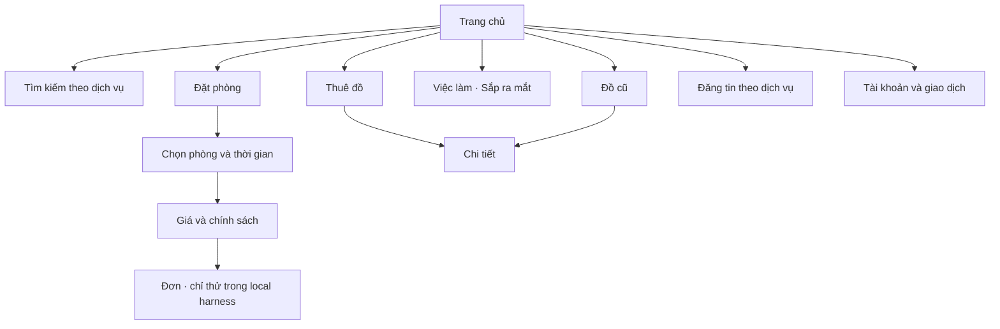

# RELOO — UI implementation checkpoint · 23/10/2026

Trạng thái: **PARTIAL, local only**. Đây là thay đổi mã nguồn chạy được, chưa phải nghiệm thu toàn bộ hệ sinh thái hay bản phát hành ứng dụng.

## Đã triển khai

- `app/product-system.css`: spacing, radius, shadow và motion token dùng màu/font hiện có; focus visible, vùng chạm, form, button, modal, table, empty state và reduced motion. Root layout nạp lớp dùng chung sau các stylesheet hiện có.
- Trang chủ và các entry tìm kiếm/đăng tin/giao dịch/việc làm: phân cấp theo tác vụ, icon cùng hệ, ít nội dung lặp, CTA theo ngữ cảnh; bỏ hero thuê đồ trùng bên dưới trang chủ tổng hợp. Giữ dữ liệu catalog thật và nhãn mức sẵn sàng.
- Tìm kiếm gửi đúng từ khóa và dịch vụ; chưa chọn dịch vụ thì đưa focus tới lựa chọn thay vì giả thành công. Posting giữ draft hiện có.
- Đăng nhập: bố cục gọn, liên kết khám phá và pháp lý; ảnh WebP qua pipeline dự án. Không đổi auth hay đọc token ở browser.
- Shared Modal: tên accessible duy nhất, focus đầu/cuối, Escape, khôi phục focus, khóa cuộn an toàn khi lồng nhau và tránh xung đột native dialog thông báo.
- Admin: menu mobile hoạt động, scrim, khóa cuộn/focus/Escape; chuông mở NotificationCenter thật; bỏ bộ chọn vai trò demo. Quyền server giữ nguyên. Logout có pending/error.
- Đặt phòng: tiêu đề ngắn, lỗi thân thiện, nhãn trạng thái/ngày giờ bản địa hóa; bỏ version giá nội bộ khỏi UI nhưng giữ kiểm tra version phía server. Không bỏ chi tiết giá/chính sách.
- `/design-preview` chỉ tồn tại khi development, production trả notFound; dùng fixture UI để kiểm tra component, không tạo giao dịch.

## Điều hướng



## Bằng chứng kiểm tra

- `output/playwright/design-20261023/index.html`: ảnh và log kiểm tra local.
- 18 route × 390/768/1440 = **54 lượt hiển thị**, không phát hiện tràn ngang trong lần chạy lưu tại `browser.txt`.
- 8 kiểm tra: focus đầu, Tab wrap, nhãn dialog duy nhất, khóa cuộn dialog lồng, khôi phục focus, reduced motion, query/domain tìm kiếm và locale English: PASS. Không có pageerror trong script; không đồng nghĩa mọi request backend đều thành công.
- Kiểm tra admin dùng **session giả lập chỉ trong browser**; API dữ liệu vẫn áp dụng quyền thật. Đây là bằng chứng tương tác UI, không phải nghiệm thu phân quyền backend.
- 57/57 kiểm tra hồi quy đã chọn PASS (`tests.txt`), gồm domain booking/rental/neighborhood và foundation/security liên quan. Không phải toàn bộ test repository.
- Ảnh đã xem trực tiếp: home mobile/desktop, booking mobile, auth mobile và menu admin. Screenshot development có thể chứa chỉ báo Next dev; chỉ báo này không phải UI phát hành.
- Build và lint: xem log đính kèm và checkpoint cuối bên dưới; không suy ra PASS từ việc đã khởi chạy lệnh.

## Phần chưa nghiệm thu

Inventory có **98 page route**, lưu `screen-inventory.json`; shared CSS áp dụng không đồng nghĩa mỗi màn đã được thiết kế/kiểm thử riêng. Các màn tài khoản, chat, checkout, chi tiết theo ID, đối tác và admin có dữ liệu cần fixture/đăng nhập được phép. Các route bị chặn đăng nhập mới được kiểm tra trạng thái chặn.

Chưa nghiệm thu toàn bộ form đăng tin/edit, keyboard thật, screen reader, tương phản từng tổ hợp, thiết bị Android tầm trung, native iPhone/Android, offline/background và hiệu năng RUM. Không coi trang giới thiệu việc làm là một hệ thống tuyển dụng đã hoàn tất.

Không deploy. App native hiện tải `https://reloo.vn`, vì vậy chưa nhận giao diện local. Nghiệm thu release cần cùng runtime/backend/catalog và kiểm tra thiết bị theo AGENTS.md. Không có thay đổi schema hay nhà cung cấp trong checkpoint thiết kế này.

## Chạy lại

```powershell
npm run stays:preview
npx --yes --package @playwright/cli playwright-cli -s=design-audit open http://127.0.0.1:4522
npx --yes --package @playwright/cli playwright-cli -s=design-audit run-code --filename scripts/design-system-browser-check.js
npm run build
```

Admin UI script riêng: `scripts/design-admin-browser-check.js`; phải giữ nhãn fixture và không thay quyền thật để phục vụ screenshot.

## K?t qu? cu?i checkpoint

- Build retry: **PASS**, exit 0; compile + TypeScript + 153 static pages/traces. Log `output/playwright/design-20261023/build-retry.txt`. L?n ??u d?ng ? SecurityFatalError; l?n ch?y l?i v?n c?nh b?o Next.js 16.4.0 ?ang c?i c? advisory b?o m?t. Ch?a n?ng dependency trong thay ??i UI n?y; c?n x? l? tr??c release.
- Scoped lint: **PASS**, exit 0, log `lint.txt` r?ng (kh?ng l?i/c?nh b?o tr?n t?p file ?? li?t k? trong phi?n).
- Full repository lint: **FAIL**, 28 errors / 63 warnings, `lint-full.txt`; c? l?i trong source c?c m?n ch?a s?a v? generated native/WASM. Kh?ng t?t rule ?? l?m xanh b?o c?o.
- Final regression selection: **76/76 PASS**, exit 0, `tests-final.txt`; thay th? s? 57 c?a l?n ch?y tr??c. Rule contract: 17 entries h?p l?.
- Admin UI fixture: **7 checks PASS**, g?m focus ??u sidebar; kh?ng x?c nh?n quy?n API th?t.
- Refresh ?nh workspace/host sau thay ??i copy: 6 l??t kh?ng tr?n ngang (`copy-browser.txt`); ?nh host ?? ???c xem l?i, kh?ng c?n l?nh terminal tr?n giao di?n.
