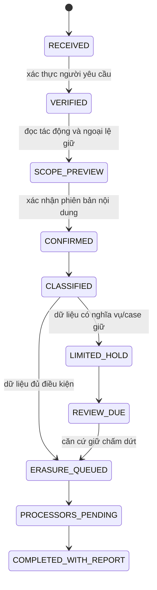

# 03 — Dữ liệu, giữ/xóa và lịch sử tài sản

**Phương án kỹ thuật/nghiệp vụ dự thảo, chưa phải chính sách công bố.** Thông tin phải đủ cho tác vụ hợp lệ, không phải “càng đầy đủ càng tốt”. Việc tài khoản còn tồn tại không chứng minh mọi bản gốc đều cần lưu đến ngày xóa tài khoản.

## Danh mục theo mục đích — không thu đồng loạt khi đăng ký

| Nhóm | Dữ liệu tối thiểu đề xuất và thời điểm | Cần thiết/không thu | Người nhận/quyền | Mốc giữ/xóa đề xuất để duyệt |
|---|---|---|---|---|
| Khách chỉ xem | Query, bộ lọc, vị trí khu vực tự chọn | Không bắt CCCD, số tài khoản, CV, GPS chính xác hoặc đăng nhập chỉ để xem | Client/API khám phá; tùy chọn đo lường tách consent | State tạm theo phiên/tác vụ; không giữ raw mãi đến xóa tài khoản |
| Tài khoản | Một kênh liên hệ/xác thực cần thiết, ID nội bộ, tên hiển thị, trạng thái | Không coi nhập cả email+điện thoại+địa chỉ+CCCD là mặc định bắt buộc; mật khẩu chỉ ở auth, không plaintext | Auth processor, support có quyền; khách khác chỉ thấy public projection | Khi còn cần cung cấp tài khoản; xóa/khử liên kết khi đóng, trừ kho giữ có căn cứ |
| Xác minh giao dịch | Danh tính cần cho vai trò/ngành, loại/số giấy tờ, kết quả/phiên bản xác minh; ảnh chỉ nếu phương thức được duyệt cần | Không thu trang giấy không liên quan, dữ liệu người thân/tài chính để “làm bằng chứng”; không tự nhận sinh trắc học/đối soát nhà nước | Nhân sự KYC được cấp, nhà cung cấp eKYC có hợp đồng; không công khai | Tách kết quả xác minh với ảnh thô; xác định hạn ngắn cho ảnh sau mục đích, hết hiệu lực/tái xác minh và xóa account; hiện chưa chốt con số |
| Sinh trắc học/video | Chỉ khi xác minh đã chứng minh cần, có notice/căn cứ và provider phù hợp | QR khác face-match/liveness; không mở rộng thành nhận dạng nền/huấn luyện AI | Nhóm nhạy cảm, ACL chặt, mã hóa, log truy cập | Hạn riêng, xóa sau mục đích hoặc giữ hợp pháp cụ thể; cần review dữ liệu nhạy cảm |
| Giao/nhận tài sản | Người liên hệ, khu vực rồi địa chỉ giao cụ thể, lịch, hướng dẫn cần | Không hiển thị căn hộ/phone đầy đủ trước khi cần; địa chỉ exact không vào analytics | Bên giao dịch cần nhận, vận chuyển theo hợp đồng | Giới hạn đến hoàn tất/hỗ trợ cần thiết; trích phần chứng từ/tranh chấp có căn cứ sang kho hạn chế |
| Cư trú nội khu | Building/ward, bằng chứng cư trú tối thiểu và trạng thái/hạn | GPS không tự là cư trú, không lấy danh sách toàn bộ cư dân | Verifier nội khu theo phạm vi, không chủ đồ khác | Hết mục đích/chuyển nơi ở/hết xác minh; quy trình xóa riêng ảnh chứng minh |
| Thanh toán/chi trả | ID giao dịch provider, số tiền, bên thụ hưởng, tham chiếu đối soát; tài khoản khi chi trả cần | Không lưu CVV/PIN/mật khẩu ngân hàng/OTP; không đòi lịch sử tài chính toàn bộ | PSP/bank, finance có quyền, kiểm toán có căn cứ | Tách khóa liên kết tài khoản khỏi chứng từ phải giữ; luật sư/kế toán xác định loại hồ sơ và thời hạn cụ thể |
| Đặt phòng | Tên/liên hệ người đặt, số khách, thời gian/gói, yêu cầu hợp lệ | Giấy tờ khách lưu trú do ai thu/khai báo phải xác định với cơ sở; RELOO không mặc định sao lưu toàn bộ | Cơ sở/nhân viên được phân quyền; không cơ sở khác | Phân loại booking chứng từ, liên hệ và yêu cầu đặc biệt riêng; chính sách đối tác/căn cứ giữ |
| Job | Liên hệ, kỹ năng, ca/khu vực, CV khi ứng tuyển cụ thể | Không public CV/CCCD, tình trạng sức khỏe/nhạy cảm nếu chưa chứng minh cần | Nhà tuyển chỉ hồ sơ được gửi cho tin/đơn vị đó | Hết tuyển dụng/xin rút; talent pool là mục đích riêng với lựa chọn riêng; chưa chốt thời gian |
| Chat/ảnh bàn giao | Nội dung do các bên trao đổi, bằng chứng cần cho hợp đồng | Không dùng chat/KYC làm quảng cáo/AI training; không gửi toàn bộ hội thoại vì một tranh chấp nhỏ | Thành viên thread, support theo case, pháp lý khi cần | Hạn riêng theo hỗ trợ/tranh chấp; lọc dữ liệu người khác trước export; không mặc định lưu công khai vô hạn |
| Log bảo mật/rủi ro | ID sự kiện, phiên, IP theo mục đích an toàn, nguồn/chất lượng cảnh báo | Không log token/mật khẩu; không kết luận gian lận từ IP hoặc một blacklist | Security/appeal có quyền; không công khai tố cáo | Hạn theo chống lạm dụng và nguồn, tự hết hạn/xem xét; legal hold phải có case và review date |
| Marketing/analytics | Các ID/sự kiện tối thiểu, public route template, consent evidence | Không gộp vào điều khoản bắt buộc; không đưa phone/email/exact GPS | Analytics/provider đã đăng ký, nếu thực sự dùng | Dừng khi rút; xóa ID tùy chọn và áp dụng lịch raw/aggregate riêng. Config hiện có không tự là thời hạn được duyệt |
| World/avatar/UGC | Profile hiển thị, avatar, nội dung/game event cần cho tính năng | Tách dữ liệu trẻ em, chat, telemetry, giao dịch vật phẩm/NFT; không tái dùng KYC mọi nơi | Người chơi theo privacy, moderator case-based, provider nếu có | Chốt trước launch, không lấy một hạn account chung cho tất cả |
| Consent/điều khoản | Purpose, version/hash, chủ thể tham chiếu, thời gian, trạng thái/thao tác | Không chỉ boolean đồng ý chung; không cần sao toàn bộ hồ sơ KYC làm chứng cứ consent | Privacy/legal có quyền | Giữ tối thiểu để giải trình căn cứ hợp lệ; hạn và liên kết phải được duyệt; rút consent không làm lịch sử đồng ý biến mất không dấu vết |
| Backup/cache/index | Bản sao và tham chiếu thực có trong hệ thống | Không hứa xóa tức thì mọi backup bất biến; không restore lại dữ liệu đã xóa vào sử dụng | Infra có quyền, mã hóa, không tra cứu thường xuyên | Chu kỳ backup được xác minh; tombstone/deletion replay trước phục vụ sau restore; thời gian cụ thể chưa được duyệt |

`compliance/field-purposes.json` vẫn giữ 548 candidate source; tài liệu này là bản nhóm mục đích để reviewer phân loại, không tự biến tất cả field thành đã cần thiết. Gắn từng field với nhóm, API/table, thông báo, role, processor và thời hạn đã ký trước khi đóng RULE-005/007/008.

## Xóa tài khoản: mô hình đề xuất

Đây là **state machine mục tiêu**, không khẳng định toàn bộ đã có trong backend. Một số gating hiện tại ngăn đóng tài khoản khi còn giao dịch/số dư; chúng không thay thế kênh tiếp nhận yêu cầu quyền dữ liệu hoặc cho phép tiếp tục marketing đã rút.

1. Tiếp nhận yêu cầu xóa/rút/hạn chế ngay cả khi chưa đóng được tài khoản; cấp mã, thời điểm và cách theo dõi.
2. Xác thực tương xứng; ưu tiên phiên đã xác thực/SmartKey. Không mặc định bắt tải lại CCCD để xóa khi có cách ít dữ liệu hơn. Có luồng hỗ trợ khi mất đăng nhập.
3. Hiển thị dữ liệu sẽ xóa, tài sản/tin bị ẩn, dịch vụ dừng; riêng dữ liệu giữ có lý do, phạm vi người truy cập, hạn/cách rà soát; không dùng một checkbox để bỏ mọi quyền.
4. Ghi bản chụp thông báo và xác nhận. Thu hồi phiên/refresh token, thông báo các thiết bị, dừng marketing. Không trả “đã xóa toàn bộ” khi job media/auth/provider chưa xong.
5. Phân loại dữ liệu theo account, tài sản, đơn, case và căn cứ giữ; legal hold có caseId, quyết định, người lập/duyệt, hạn review. Không lấy lý do “có thể tranh chấp” để giữ mọi dữ liệu vô hạn.
6. Xóa/ẩn danh đủ điều kiện ở DB chính, object storage, thumbnail/CDN, search, cache, queue/outbox, auth, processor. Retry/idempotency và chống restore trái phép. Bản sao bên đối tác độc lập cần được thông báo và xác định trách nhiệm.
7. Ghi báo cáo máy và thông báo người dùng: xóa gì, còn gì, vì sao, ai xử lý, ngày review; phần giữ kết thúc thì phát sinh lệnh xóa tiếp. Thời hạn pháp luật cần luật sư đối chiếu, không lấy SLA nội bộ thay thời hạn bắt buộc.

## Lịch sử tài sản sau khi người dùng xóa

- Mục tiêu sản phẩm: còn sự kiện thuê/mua, loại tài sản, mốc thời gian cần thiết, tình trạng bàn giao và chứng cứ tối thiểu theo căn cứ phù hợp.
- Công khai cho chủ tài sản/khách khác chỉ projection được duyệt: “tài khoản đã xóa” và thông tin không nhận dạng. Không giữ avatar, tên, CCCD, phone, địa chỉ, location exact, nội dung chat trong timeline công khai.
- Kho chứng từ hạn chế có thể cần liên kết còn nhận dạng; **không gọi kho đó ẩn danh**. Ngăn chủ mới/khách khác xem, hạn truy cập theo case, mã hóa, audit và hạn giữ.
- Hash danh tính, ID nội bộ, timestamps/địa điểm hiếm và ảnh vẫn có thể tái nhận dạng. Nếu không chứng minh khử nhận dạng thực sự, tiếp tục coi là dữ liệu cá nhân.
- Hóa đơn/hợp đồng cũ không bị sửa tên bên giao dịch chỉ để tạo cảm giác đã xóa; giữ chứng từ gốc có căn cứ, tách khỏi hồ sơ đang dùng và giải thích cho người yêu cầu.
- Việc ai được xem lịch sử giao dịch của ai phải dựa trên ownership/participant/case ở server, không dựa vào `app=...` hay client role.

## “Chỉ nội bộ” và cung cấp cơ quan

Phải lập recipient map đúng thực tế: Auth/hosting, eKYC, ngân hàng/PSP, email/SMS/push, vận chuyển, cơ sở lưu trú/nhà tuyển, analytics khi đã chọn. Một số là bên xử lý theo chỉ dẫn, một số có vai trò độc lập; hợp đồng quyết định trách nhiệm chứ không gọi tất cả là “nội bộ”. Nêu vị trí xử lý và đánh giá chuyển xuyên biên giới khi có, không khẳng định mọi dữ liệu ở Việt Nam chỉ vì server chính tại VN.

Yêu cầu cơ quan: xác minh cơ quan/người ký/thẩm quyền/phạm vi, văn bản/case, người duyệt nội bộ, dữ liệu tối thiểu và cách chuyển an toàn; lưu log giao nhận và giới hạn sử dụng. Có tranh chấp không tự cho phép gửi hồ sơ cho bất kỳ bên nào hoặc đăng công khai tố cáo. Quyết định lưu/cung cấp theo căn cứ được xác nhận, không “chờ cơ quan yêu cầu mới quản lý quyền”.

## Nguồn đã đọc và giới hạn

[Luật 91/2025/QH15, bản chính thức](https://datafiles.chinhphu.vn/cpp/files/vbpq/2025/7/91qh.signed.pdf): đã xem trực tiếp trang PDF2–9 (Điều3,4,9–16),23 (Điều39 chuyển tiếp). Nguyên tắc mục đích/thời gian tại Điều3; quyền/đồng ý/rút lại/xóa tại Điều4,9,10,14. Không dựa vào riêng các điều này để kết luận toàn bộ ngoại lệ/biểu mẫu/thời hạn. [NĐ356/2025](https://vanban.chinhphu.vn/?pageid=27160&docid=216387) và toàn bộ luật chuyên ngành cần được luật sư hoàn tất đối chiếu; có ảnh trang nguồn/hash trong artifact nghiên cứu.
