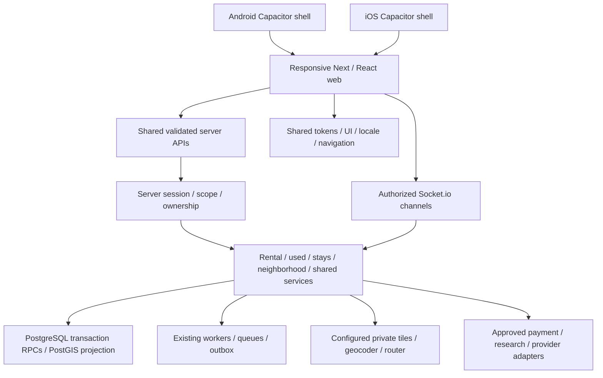

# V4 architecture and boundaries

Status: VERIFIED_EXISTING_ARCHITECTURE + CONTROLLED_EXTENSION; no rewrite/microservice migration.

Existing native applications are hybrid shells, not assumed independent React Native/Flutter apps. Share primitive values and contracts, not arbitrary browser components inside native controls. Native permissions, lifecycle, deep links, safe areas and accessibility require device-specific behavior and tests. No native changes are bundled merely because shared web changed.

Module boundary: `lib/product/modules.js` declares discover/post/manage/transaction navigation and availability. Status never grants identity or money authority. Server boundaries stay `requireAccount`, origin checking, validation, transaction RPC, provider verification and idempotent domain state. No browser public-schema privileges, JS-readable auth tokens or secret-bearing user payloads are introduced. Business data remains the source of truth; socket messages are scoped deltas, not durable transaction authority.

Image pipeline: owner input → bounded local normalization → existing media persistence/rollback → shared resilient renderer. Do not treat external asset availability as rights verification. Map pipeline separates source data refresh, public approximate business features, private exact point and explicit device GPS; do not label all four realtime. Provider/config readiness remains gated.

Added foundation: palette-derived platform-neutral primitives, web CSS variables, localized unique search relationships, keyboard main bypass and robust shared image states. CI checks contracts and tests, not subjective premium scores. Keep HTTP/request/API contracts stable and migrate one component family at a time.

Proposals, not implemented: approved original-evidence storage, derivative image manifest/CDN, complete permission-aware address service across all booking domains, field CWV telemetry with consent, native performance device lab and current isolated staging. These need design/operational/business acceptance before introducing new persistence/providers. World/UE5/game integrations are excluded and unchanged.
